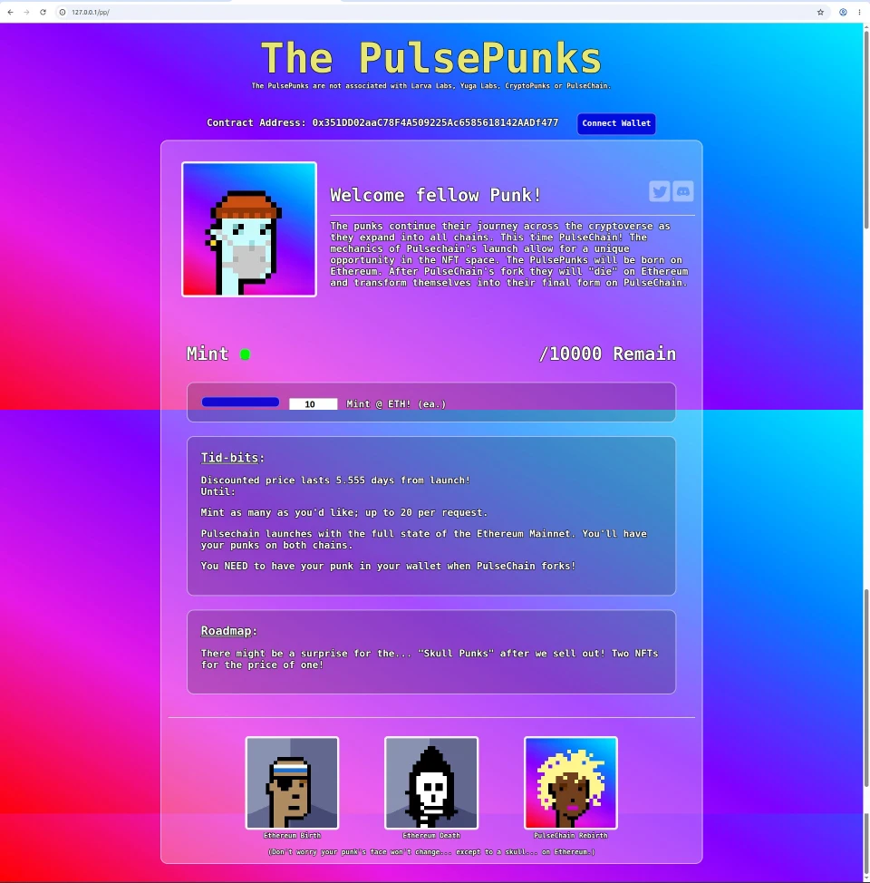

# PulsePunks

PulsePunks was an NFT collection built, during the summer of 2022, around the planned Ethereum-to-PulseChain state fork; intended to bring the `CryptoPunks` to PulseChain. The idea was to mint a collection on Ethereum before the fork, then give the two resulting chains different artwork: skull versions on Ethereum and the original characters with new backgrounds on PulseChain. It reached a working local prototype but was never publicly launched.

## What I built

*owner*: contract owner; developer

  ### Contract and asset code
 
  • NFT contract: A 10,000-token ERC-721 collection with public batch minting and owner-reserved whitelist tokens.
 
  • Mint controls: The owner can pause minting and select the chain on which public minting is allowed.
 
  • Pricing: The contract uses a discounted price for the first 479,952 seconds after launch, then a normal price. Pulsians have an obsession with 5 apparently. (5.555 days)
 
  • Fork concept: As above, supported different artwork on Ethereum and PulseChain. The change occurs with owner action as the exact block time of the fork was known only to PulseChain creators.
 
  • Metadata and royalties: Token IDs map to IPFS JSON filenames; the contract also reports EIP-2981 royalties.
 
  • Asset pipeline: JavaScript reads source SVGs and attributes from the Ethereum blockchain; PHP generates background and skull variants and prepares IPFS metadata. De-duped skull images using md5-based filenames.

  • IPFS: Local node was setup and run to host image assets. Storage footprint lessened using "RLE" in SVG files by giving `rect` widths values other than `1`.
 
  • Efficient Mapping: `IMap` gives the payment splitter direct member lookup and removal while retaining an enumerable member list.
 
  • Dependencies: The ERC-721 implementation and most Solidity includes are OpenZeppelin-derived. `PulseChain.sol` extends these objects.
 
  ### Website
 
  • Wallet and network: Connects through MetaMask, shows the selected account, and checks the wallet’s chain.
  
  • Remaining supply: Reads `totalSupply()` on load and listens for Transfer events to update on-page values live.
  
  • Mint indicator and button: Reads `paused()` on load and responds to Paused and Unpaused events. The "Mint (light) [Status]" is updated accordingly. `{red, yellow, green} {Ended, Paused, Live, [etc]}`
  
  • Price and discount date: Intended to read the price and launch timestamp from the contract; the date adds the fixed discount period to that timestamp.
  
  • Mint feedback: Shows a pending transaction hash, confirmation, or an error.
  
  • Static presentation: The contract address, collection limit, project explanation, and example artwork are embedded in the page.
 
## Screenshot

The original Ganache development environment has been decommissioned some time ago. Several aspects of the page will not render properly without blockchain access: supply count, mint price, and discount end time are populated by contract calls.
